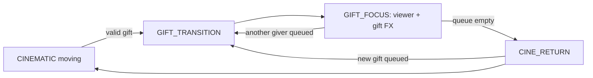

# 04 — Cinematic 3D Camera Director

**Important:** User-confirmed operational gift interruption / FIFO / return requirements are specified normatively in [09_GIFT_CAMERA_DIRECTOR.md](09_GIFT_CAMERA_DIRECTOR.md). 04 specifies cinematic world path and visual cinematography; it must not override 09.

## Cinematic behavior

Camera must **always keep moving while there is no pending/active gift focus**, following a soft, smooth repeating movie-like route. These modes come from the example video and must be achievable using real 3D parallax, not 2D static art:
- `CLOSE`: 1–3 foreground avatars near the water, readable nameplate.
- `COMMUNITY`: 8–30 characters, with lake, mountains and sakura tree in the background.
- `AERIAL`: fly high above canopy and lotus-pad formations, revealing dense crowd and landmark pink tree (video approx. 12–19s).
- `UNDER_TREE`: fly below/beside large branches, dark trunk silhouette, misty pink backlight.
- `CLOSE` / `COMMUNITY` again via smooth spline loop.

## Interruption by gifts — user-approved

Default camera owner is `CINEMATIC`. When gift events yield valid identified giver focus requests, transfer camera to `GIFT_TRANSITION`, then `GIFT_FOCUS` on **that giver's actual avatar/seat**, ensuring name, avatar and gift effect in close-up. When focus shot ends, advance **FIFO to other gifters** without jumping to cinematic if queue still has people. When queue is empty, `CINE_RETURN` blends to a suitable point in cinematic path and resumes constant movement. Additional gifts while a focus is active join the queue; prioritize fair turn-taking rather than monetary value. Progress vs final gift is distinguished as in 09 and 05.

Manual camera override is allowed for operator, but gift queue must remain bounded and visible in dashboard. Details in 09.

## Camera path / framing technical requirements

Store camera `position`, `target/lookAt`, `FOV`, `near/far`, `path progress`, `mode`; use smooth splines/easing for movement, damping for lookAt and nameplate collision/culling; constrain excessive roll and keep foreground avatars in focus. Ensure sakura tree remains landmark across aerial and under-tree shots. Avoid camera occlusion by canopy when framing gifters. Dynamic gift focus anchor must use actual seat location; never estimate position from username text.

## Approximate DEMO script for reference (not a hard runtime timeline)

- 0–5s: CLOSE
- 5–11s: COMMUNITY smooth orbit
- 11–17s: AERIAL gradual rise/flyover
- 17–23s: UNDER_TREE near trunk, pink atmosphere
- 23–30s: COMMUNITY
- 30–38s: CLOSE / guest view
- 38–45s: COMMUNITY

These timestamps approximate the **camera choreography in the sample video**; in runtime gift focus can interrupt **any** cinematic shot. When no gifts, the path loops continuously and never becomes static. Resuming after gift is via eased blend into the next coherent path location (not teleport).

## Initial tunables (proposed, not locked)

`cameraAuto`, `cameraMode`, `cinePathSpeed`, `shotHoldMs`, `transitionMs`, `focusHoldMs`, `focusMaxMs`, `returnMs`, `maxPendingGifters`, `focusOnObservedGift`, `motionReduced`, `replaySeed`. Concrete initial values, fairness, queue, gift lifecycle and sequences: **09**.

## Acceptance

- No-gift 45s demo cycles close -> crowd -> aerial -> under-tree -> crowd without stalling.
- If A gives during aerial, camera completes smooth transfer to A and displays A + name + gift.
- B, C give while A is focused -> B then C get individual focus.
- No queued gifts after last close-up -> seamless blend to moving cinematic.
- Fits vertical frame and passes GPU 4GB/8GB preset checks in **10**.
