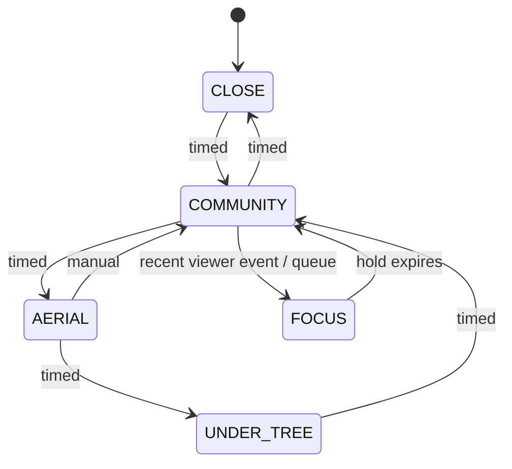

# 04 — Cinematic camera director

Camera movement is **central** to faithful reproduction; not optional UI polish. Sample video visibly sweeps from near-water focus into full aerial overview and back to ground level. These are inferred shot categories, not a claim about exact camera algorithm.

## State machine

Required modes:
- `CLOSE`: 1–3 foreground avatars, view near water and slightly above leaf, readable name.
- `COMMUNITY`: 8–30 visible avatars, tree and mountains as background, gentle dolly/pan.
- `AERIAL`: flyout rising above tree and seating arc; dramatic top-down overview of pink tree and crowd. MUST see hundreds of pads possible via LOD, not simulate 100 individual expensive materials.
- `UNDER_TREE`: pass trunk/branches while looking over group into pink fog, strong dark silhouette.
- `FOCUS`: optional timed highlight for specific event/seat, camera eases to actor and returns.
- `MANUAL`: operator may choose shot; return to auto gracefully.

## Initial choreography for DEMO (proposed)

0–5s CLOSE, 5–11s COMMUNITY with slow lateral motion, 11–17s AERIAL rising/flyover, 17–23s UNDER_TREE, 23–30s COMMUNITY, 30–38s FOCUS/CLOSE, 38–45s COMMUNITY hero. These approximate video cuts/moves rather than hard facts; timing adjustable in config. Loop seam must not teleport; continuous camera path or eased blend.

## Technical

Store camera **position, target/lookAt, FOV, near/far, path progress, mode**; use spline/Catmull-Rom for positions + smooth target interpolation, clamp roll to zero, ease to avoid motion sickness. Use ray/occlusion avoidance so trunk or canopy does not fully block focal avatar. Reframe by target group bounding box; update target with critically damped spring smoothing. Use perspective for scale change and real parallax. Dynamic focus should yield to existing scheduled shot with cooldown not switch each gift.

Proposed controls:
`cameraAuto`, `cameraMode`, `orbitSpeed`, `shotHoldMs`, `transitionMs`, `eventFocusCooldownMs`, `showNameplatesAtDistance`, `motionReduced`, `replaySeed`.

Do not reuse V1 `packages/shared/src/camera.ts` as a 3D camera path; can reuse generic easing/priority concepts only after review. Need deterministic camera snapshot tests and 9:16 safe area tests.
