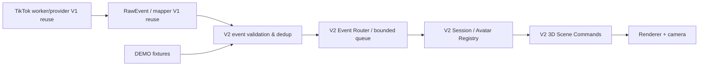

# 05 — Live interactions, avatars, gifts and safety

## Preserve proven V1 connector; new V2 scene semantics

Verified in V1 GitHub main:
- `apps/server/src/tiktok/worker.ts`: separate process `tiktok-live-connector`, maps `CHAT, MEMBER, GIFT, LIKE, ROOM_USER`; bounded IPC; graceful shutdown.
- `apps/server/src/tiktok/transport.ts`: `WorkerConnectorTransport` isolate I/O and stop.
- `apps/server/src/tiktok/provider.ts`: `TikTokLiveProvider`, connection / reconnect / rate-limit / status / event fanout.
- `apps/server/src/tiktok/mapper.ts`: `mapTikTokEvent`, Zod validation; eventId, room scope, user fields, gift streak id, finished/progress.
- `packages/shared/src/live.ts`: username/status types.
- `apps/server/src/sources.ts`: `SourceManager` currently constructs **V1 `SceneEngine`** for both demo/live — MUST NOT copy that dependency as-is into V2. Replace adapter sink and V2 scene model.
- `packages/shared/src/client.ts`: socket snapshot/delta resync versioning, reusable idea; requires new V2 state types or compatible protocol.
- `apps/server/src/engine.ts`: old spawn/seat/ritual and gift code MIXED with event dedup; **extract only tested generic behaviors** instead of porting giant V1 scene engine.

## Target event pipeline

Use `userKey` normalized identity, room/session scoped. Per-user actor instance exactly 1; update label/avatar and lastSeen if event repeats. Scene registry separate from shader/mesh objects. Seat manager assigns deterministic unique lily pad, and frees it after TTL/graceful departure; bulk queue on seat shortage.

## Event to visual mapping (gift camera behavior CONFIRMED by owner; other event spawn defaults proposed)

| Event | Default V2 candidate | Must not do |
|---|---|---|
| member | configurable join trigger (default OFF until approved) | Never assume TikTok member event reliable for EVERY viewer |
| chat | if configured spawn or refresh avatar, show moderated small bubble | Don't execute untrusted chat as HTML/commands |
| follow | only when connector support/verified, may spawn/focus | Do not pretend existing worker receives follow by default |
| like | optionally trigger small soft ripple/tree pulse, rate-limited | Never spawn hundreds of actors from like count |
| gift: rose | **Required:** enqueue giver for close-up, show their avatar/name and pink petals/ripple; process other gifters FIFO; return cinematic when empty. Provisional combo progress acknowledged without confirmed count. | Never double count streak or repeatedly refocus same progress |
| higher gift | **Required same fairness:** focus its giver in FIFO order; heavier FX only if performance allows | Don't jump another giver ahead because gift costs more; don't flood camera |
| roomUser | update viewer count only | Never equate total count with per-user identities |
| disconnect/reconnect | pause arrivals; preserve and resync scene by room/session; no dup | Never replay stale events or copy LIVE credentials |

For the new viewer avatar rule, enable **configurable switches**:
`spawnOnChat`, `spawnOnMember`, `spawnOnGift`, `spawnOnFollowWhenSupported`, `maxAvatars`, `avatarTTL`, `cameraFocusOnGift`. Owner must approve production defaults.

## Domain details critical to correctness

V1 `mapper.ts` yields gift `finished` when gift type !== 1 or repeatEnd === 1; progress when unfinished and streak identity trustworthy. `engine.ts` dedups scoped event keys, queue cap 2048, and separately confirms final gifts via gift handler. Extract this logic or test semantics against fixtures rather than duplicating naive gift counting.

IMPORTANT: In old V1 `engine.ts`, `member` spawn depends on `autoJoinMember`; chat spawn depends on `autoJoinChat`; `like` explicitly does not spawn actors. No assumption these are V2 defaults.

Use active nameplate culling (distance, priority, overlap), grapheme-safe Unicode clipping. Mask/clean text. Queue and TTL; no raw TikTok user IDs written to public logs, no token/cookie in source, do not reuse V1 production session files. Throttle FX and camera changes. On burst, retain true state and discard redundant visual effects first.

## Camera/gift integration: approved rule

**Owner confirmed:** when no gift queue, camera rotates continuously as cinematic. When a gift is recorded, camera focuses close-up on the correct giver's avatar and effect, then focuses the next queued *different giver* if any; once none remain, smoothly resumes cinema. See [09_GIFT_CAMERA_DIRECTOR.md](09_GIFT_CAMERA_DIRECTOR.md) for queue/coalescing/transition/event-lifecycle spec and [10_GRAPHICS_PROFILES.md](10_GRAPHICS_PROFILES.md) for 4GB/8GB GPU constraints.

**Key implementation detail:** reserve/ensure a temporary avatar for the giver even if regular spawnOnChat or member is disabled. Do not infer that viewer counts equal identities. With combo events, allow prompt provisional camera response for valid observed streak but only show *confirmed* count/reward after finished event; no duplicate camera entries per progress packet.

## Mock demonstrations

Recorded/synthetic fixture sequence:
- 20 users chat with Vietnamese diacritics -> unique seats; duplicate event -> same actor.
- 100 member bursts -> bounded queue and stable FPS.
- One rose streak with progress, then finished -> one logical confirmed sequence.
- Like storm 500 units -> <= configured FX rate, no phantom actors.
- Reconnect same room, then new room -> no historical replay; reset when room changes.
- No gifts for >=45s -> continuous cinematic cycle, camera never freezes.
- A gives, then B/C before A shot ends -> close A, B, C then return cinematic; correct name/FX each time.
- A sends 5 combo progress packets and one finished -> one giver focus/queue slot, final confirmed quantity accurate.
- Gift giver not previously spawned -> create visible seat/temporary avatar then focus; if capacity exhausted, show non-misleading fallback instead of wrong avatar.
