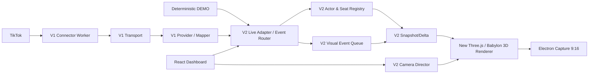

# 06 — Architecture / actual V1 reuse audit

**Audit source:** `https://github.com/nguyenbui5701/OnlinePagoda`, branch `main`; relevant source files read via GitHub connector on 2026-11-20. This is a targeted code review, NOT a full local test run. V2 repository was empty before design creation.

## Actual V1 stack (verified)

`package.json`: Node >=22.12, TypeScript, Vite, React dashboard, PixiJS 8 renderer, Socket.IO, Express, Electron capture, `tiktok-live-connector@2.5.0`. The PixiJS overlay is not a 3D scene and should not be transplanted as primary renderer.

## Reuse matrix

| Component | V1 exact path | Reuse decision | Reason / caveat |
|---|---|---|---|
| Connector worker | `apps/server/src/tiktok/worker.ts` | **YES** | stable TikTok incoming events, IPC bounded |
| Transport | `apps/server/src/tiktok/transport.ts` | **YES** | child process lifecycle |
| Provider | `apps/server/src/tiktok/provider.ts` | **YES** | retry, disconnect, fault, state and event |
| Event mapper | `apps/server/src/tiktok/mapper.ts` | **YES** | validated RawEvent, gift streak semantics |
| Usernames / connection | `packages/shared/src/live.ts` | **YES** | status + validation |
| Demo source | `apps/server/src/provider.ts` | **ADAPT** | mock event fixtures, not V1 theme copy |
| SourceManager | `apps/server/src/sources.ts` | **REWRITE SMALL BOUNDARY** | currently new SceneEngine(settings) twice; must inject V2 engine |
| SceneEngine | `apps/server/src/engine.ts` | **SELECTIVELY EXTRACT** | V1 actor/seat/ritual logic mixed with generic dedup/gift |
| Shared schemas | `packages/shared/src/index.ts` | **EXTRACT / NEW V2 TYPES** | too many temple-specific settings and entities |
| Snapshot/delta client | `packages/shared/src/client.ts` | **ADAPT** | resync strategy useful; V2 state type differs |
| Express + socket | `apps/server/src/app.ts` | **REUSE PATTERN** | dashboard command, telemetry, snapshot/delta; narrow V2 API |
| Camera | `apps/server/src/camera-director.ts`, `packages/shared/src/camera*.ts` | **REWRITE 3D**, selectively borrow priority | V1 view switching not same as 3D flythrough |
| Pixi scene | `apps/overlay/src/main.ts`, `apps/overlay/src/golden/**` | **NO for primary world** | 2D scene; wrong target visual |
| React dashboard | `apps/dashboard/src/LivePanel.tsx` | **REUSE CONCEPT / COPY LIGHT** | LIVE connection controls already usable |
| E2E scripts | `scripts/e2e-live.mjs`, `scripts/e2e-live-mobile.mjs`, `scripts/e2e-multicamera.mjs` | **ADAPT TEST CONTRACTS** | verify connector, mock, capture and camera variants |

## Proposed architecture

SceneEngine V2 responsibilities: maintain room scoped user/session keys, snapshots/deltas, deterministic assignments, independent clock/frame clock, fallback when disconnected. Render client owns GPU meshes, visual particles, nameplates, camera interpolation. No direct TikTok network I/O in renderer.

## First technical spike required

Choose renderer only after measurement; **Three.js preferred exploration candidate** because existing app uses browser/Electron, but Babylon acceptable if prototype is better. Need minimum: scene water + 30 pads + 12 rigged chibi + big sakura tree, 4 camera shots, gift ripple, nameplates, capture 9:16. Run actual stream PC test; report FPS, VRAM, build complexity, feasibility of instancing/LOD.

## V1 integration traps

- V1 default `autoJoinChat:true`, `autoJoinMember:false`; `like` never creates actors. V2 default must be explicitly decided rather than copied by mistake.
- V1 `worker` listens `chat/member/gift/like/roomUser`; does NOT demonstrate follow subscription.
- In V1 `SourceManager` is hardwired to `SceneEngine`. Merely importing it into V2 would bring all temple-specific behavior with it.
- V1 `SceneEngine.receive` handles event dedup, scope/session and capped queue. Reuse concept but test event identity / gift finish.
- V1 `client.ts` snapshot/delta with revision checks requires V2 counterpart data schema.
- Both V1/V2 should keep separate config/session/ports/capture name to avoid impacting production live.

## V2 event-driven camera addendum (owner-approved)

V2 requires a **GiftFocusScheduler** independent from TikTok worker and 3D renderer. Ingest validated identity-scoped gift observations/final confirmations, collapse combo repeats and same-giver pending items, FIFO across distinct gifters, bound queue and TTL, expose instrumentation. `CameraDirector3D` consumes the scheduler, switches from auto cinematic to giver-focus shot and returns only when queue is empty. `AvatarRegistry/SeatManager` ensures the giver has a focusable position and nameplate; `GiftEffectRouter` emits targeted FX. **Do not** reuse V1 camera-switch implementation as-is. See [09](09_GIFT_CAMERA_DIRECTOR.md).

Rendering must have **two quality profiles** for RTX 3050 Ti 4GB and RTX 3060 8GB; choose renderer by actual 4GB-machine benchmark, not by theoretical scene complexity. See [10](10_GRAPHICS_PROFILES.md).

## Separate AI asset producer and Codex consumer

AI 3D creates and owns asset pipeline (`*.blend`, `*.glb`, textures, rig, animations, LODs and manifest) under SA quality checks. Codex only produces code for V2 Event Engine, GLB runtime loading, shader water/fog, scalable scene and camera. The handoff contract is defined in [11](11_3D_ASSET_PRODUCTION_PIPELINE.md), [12](12_CORE_PRIORITIES_AND_AI_ROLES.md), [13](13_3D_EVENT_INTEGRATION_CONTRACT.md). Most development priority goes to these two P0 workstreams; don't build a temple UI before the world, event scheduler and cinematic/gift focus work.

## Repositories

V1: source only for reference/copy targeted files, **read-only** for this project. V2: own repo, no auto-mutating original. Never commit credential files or node_modules/dist. Design folder only until approved.
