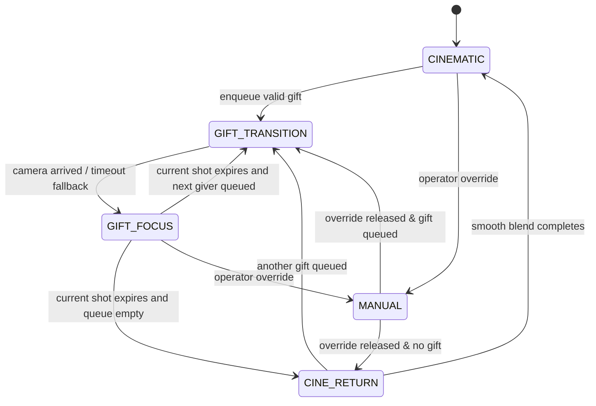

# 09 — Gift-aware Cinematic Camera Director (OWNER-APPROVED RULE)

**Status:** Requirement confirmed by owner on 2026-11-20. This document is normative for V2 camera behavior. Video reference remains visual ground truth. See 04 for camera geometry and 05 for TikTok event semantics.

## 1. Business rule (must implement)

> Khi không có người tặng quà trong hàng chờ, camera tự động quay vòng qua các shot cinematic (CLOSE -> COMMUNITY -> AERIAL -> UNDER_TREE -> ...), di chuyển mượt như video. Khi ghi nhận quà tặng của một người có danh tính hợp lệ, đặt người đó vào hàng chờ và chuyển camera cận nhân vật của họ; hiện đúng avatar/tên người tặng và hiệu ứng quà tương ứng. Kết thúc shot của người đó thì chuyển sang người tặng khác trong hàng chờ (nếu có). Khi hàng chờ hết, camera trở lại chu trình cinematic tự động.

**Các quy tắc không được sai:**
- **No gifts queued:** camera tiếp tục CINEMATIC, không đứng yên chờ.
- **Gift recorded:** đối tượng tặng quà được nhắm đúng dựa trên identity + room/session; không được focus ngẫu nhiên.
- **Several gifters:** xử lý theo FIFO **giữa các người tặng**, không chỉ quay một người rồi mất quà khác.
- **Return:** khi queue trống + focus hiện tại kết thúc, hòa chuyển (blend) mượt sang cinematic hợp lý, không teleport.
- **Every giver has an avatar/seat for focus:** nếu chưa hiện trong hồ, tạo seat tạm qua V2 avatar registry, xử lý capacity; nếu không thể có actor thì hiển thị overlay fallback tên/avatar/gift, tuyệt đối không focus người khác.
- **Exact sequence:** nameplate và effect phải ở vị trí hợp với góc quay; animation và phản hồi từ gift không được chạy xuyên qua mặt người tặng.

## 2. Camera scheduling state machine



`CINEMATIC` delegates to scripted camera timeline from 04, e.g. CLOSE -> COMMUNITY -> AERIAL -> UNDER_TREE. `GIFT_TRANSITION` interpolates to a chosen near-front or three-quarter view of the actor (name visible, full seated body and lotus leaf in frame). `GIFT_FOCUS` pins lookAt to actor/leaf target and plays effect. `CINE_RETURN` blends toward next natural cinematic anchor; do **not** resume by teleporting to a wildly different path position.

## 3. Queues, coalescing, fairness

Use **scene-side**, independent, bounded queue; TikTok worker must never block waiting for camera animation.

Suggested data model:
```ts
type GiftFocusRequest = {
  requestId: string;             // idempotent stable event/streak key
  roomId: string;
  userKey: string;               // stable user/room scoped key
  displayName: string;           // moderated/bounded
  avatarUrl?: string;            // sanitized URL only, never untrusted HTML
  giftId: string;
  giftName?: string;
  count: number;                 // provisional if gift progress
  status: 'observed' | 'confirmed';
  firstSeenAt: number;
  lastSeenAt: number;
};
type CameraMode = 'CINEMATIC' | 'GIFT_TRANSITION' | 'GIFT_FOCUS' | 'CINE_RETURN' | 'MANUAL';
```

- Keep one pending **slot per giver**. If same giver sends more gifts while pending, aggregate gifts/counters for that giver rather than append unlimited duplicate shots. If same giver sends while being focused, extend shot **once** up to max hold (never hold indefinitely); remaining gifts can generate a new slot only after fairness guard.
- Different givers are served in **first-seen order**; do not reorder based on gift coins or economic value.
- Recommended initial values (tunable, validate on video+hardware): `transitionMs=800–1400`, `focusHoldMs=4500–6500`, `focusMaxMs=9000`, `returnMs=1000–1800`, `maxPendingGifters=32`, `requestTTLms=90000`.
- If request queue full: aggregate same-giver requests; other arrivals get brief on-screen acknowledgement and diagnostics. Do **not** silently block TikTok input. If queue full, avoid claiming the giver will receive a dedicated focus shot.
- Any active giver should be focusable without waiting for unrelated seat queue; use seat reservation/temporary visible focus spot. Handle name clipping, missing profile photo with neutral fallback avatar, stale actor, camera occlusion. If room changes, cancel stale pending requests safely.
- If multiple viewers send concurrently, a current focus has a short uninterruptible minimum hold to prevent rapid cuts. Queue newcomers; do not instantly cut to the latest high value gift.
- Use smooth camera blends with easing and camera collision avoidance; avoid strobe/flash. Prioritize frame readability over 1:1 mechanical timing.

## 4. Gift progress vs confirmed gift

V1 `mapTikTokEvent` distinguishes gift combo **progress** (`finished=false`) and **finished**. Requirement “ghi nhận quà” means users should feel acknowledged promptly, but correctness demands no duplicate scoring:

- **Valid initial observed event** (including combo progress with trustworthy streakId): may request one provisional camera focus promptly, with neutral visual notification ("đang gửi quà" / visual flourish) but **must not** increment confirmed gift totals or claim exact count.
- **Confirmed final event**: attaches/matures the same focus item by idempotency key; updates accurate gift count and triggers confirmed gift acknowledgement/effect. If no prior observed focus, enqueue one new request.
- Never enqueue one focus for **every** combo progress update. Key `room + user + gift + streak/order` where available; use provider-provided stable event IDs and bounded fallback to avoid duplicate focus when same payload replays.
- A gift event with missing trustworthy giver identity must not focus a guessed actor; log sanitized reject/fallback.
- If provisional combo never confirms, expire/cancel its provisional visual; no false “confirmed gift” text or scoring. Replay handling and message ordering must be tested.

## 5. Event sequences (acceptance)

**No gift**:
`CINEMATIC(CLOSE) -> CINEMATIC(COMMUNITY) -> CINEMATIC(AERIAL) -> CINEMATIC(UNDER_TREE) -> ...`

**A sends**:
`CINEMATIC -> GIFT_TRANSITION(A) -> GIFT_FOCUS(A: avatar + name + gift FX) -> CINE_RETURN -> CINEMATIC`

**A then B while focusing A**:
`CINEMATIC -> GIFT_FOCUS(A) -> GIFT_TRANSITION(B) -> GIFT_FOCUS(B) -> CINE_RETURN -> CINEMATIC`

**A, B, C almost simultaneous**:
`queue=[A,B,C], active=A -> B -> C -> cinematic` with stable FIFO and bounded queue.

**A repeated, B queued**:
`active=A, queue=[B], A's second gift merges into active A (bounded hold), then B next`; A must not starve B.

**Camera returning, new C**:
`CINE_RETURN -> GIFT_TRANSITION(C) -> GIFT_FOCUS(C)`, blended from live camera pose (no jump).

**Manual override**:
If operator explicitly selects MANUAL, hold manual view; gift requests enqueue bounded with TTL and are served on return to AUTO unless expired. Provide manual "clear queue" control with confirmation.

## 6. Video-fidelity shot specs

Gift close-up must resemble video 28–38 s: 1 seated chibi in foreground, leaf visible, lake visible around character, name/bubble readable; other avatars in soft background. Optional camera side angle to avoid overlapping nameplates. Gift effect e.g. pink rose petals/ripple beside/above the correct avatar, not a giant full-screen banner. Cinematic overview from video 12–19 s must still recur when queue eventually empties.

## 7. Implementation boundaries

- `GiftFocusScheduler`: pure/serializable state, ingest normalized event, dedup, FIFO, TTL, consume next, tests.
- `CameraDirector3D`: own camera animation, transition, hold, return and manual; consumes scheduler; does not contact TikTok.
- `AvatarRegistry/SeatManager`: ensure presenter exists; returns world anchor position and safe lookAt target.
- `GiftEffectRouter`: routes specific gift to actor location and visual quality level.
- Dashboard: queue size, active giver, pending, dropped/expired counts, AUTO/MANUAL.

**Source origin:** user-confirmed business rule; exact durations and capacity are design defaults subject to benchmark, not observed measurements.
